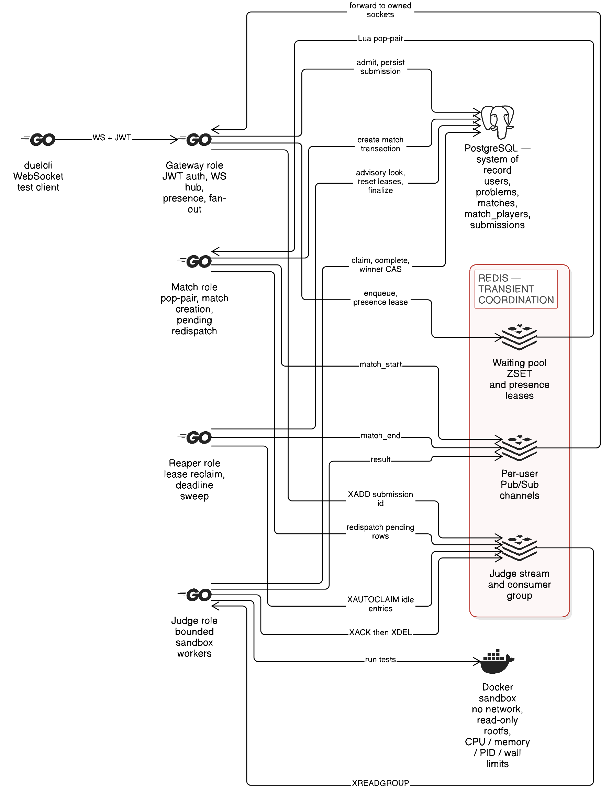

# CodeDuel

Real-time backend for 1v1 programming duels. Two players enter a FIFO queue, receive the same problem, and race to the first fully correct submission.

**Stack:** Go 1.26.6+, PostgreSQL 16, Redis 7, Docker; Kubernetes and AWS infrastructure via Pulumi (Python).
**Clients:** `duelcli`, a WebSocket test client, and a React browser client maintained separately in [CodeDuel-frontend](https://github.com/nglong14/CodeDuel-frontend).


https://github.com/user-attachments/assets/6572aa6e-ee60-47d7-ae2c-93df52a441c4


## Run it locally

**Requires:** Go 1.26.6+ for the CLI and host-run roles, Docker, and Docker Compose. The Docker Judge requires a Linux Docker daemon with seccomp enabled and enforced CPU, memory, swap, and PID limits.

Configuration loads `.env` if present. If you do not already have one, copy the development defaults:

```sh
cp .env.example .env
```

1. Start PostgreSQL, Redis, migrations, Gateway, Match, and Reaper:

   ```sh
   make up
   ```

2. Build the sandbox images and start Judge in a separate Compose stack:

   ```sh
   make sandbox-images
   make up-judge
   ```

3. Load the development-only fixture users (Alice and Bob). These are not part of
   the production migration sequence, so seed them explicitly:

   ```sh
   make seed-dev
   ```

4. Open two terminals and start the fixture players:

   ```sh
   make run-cli USER_ID=11111111-1111-1111-1111-111111111111
   make run-cli USER_ID=22222222-2222-2222-2222-222222222222
   ```

5. Type `join` in each client. Both receive `match_start`.

6. Submit a solution using one of the supported language names (`python`, `cpp`, `java`):

   ```text
   submit-file python /path/to/solution.py
   ```

   For a single-line program, use `submit <language> <code>`. The CLI remembers the match ID from `match_start` and prints judging/result events.

The fixture CLI commands mint development JWTs using `JWT_SECRET`; they are not a production sign-in flow. For a registered account, pass the token returned by login or registration:

```sh
go run ./tools/duelcli -url ws://localhost:8080/ws -token '<token>'
```

Stop services with `make down` and `make down-judge`; these preserve volumes. **`make migrate-down` rolls back migrations, and `make reset` removes development volumes and data.**

### Run roles directly on the host

Instead of `make up`, start only the dependencies and apply migrations:

```sh
make up-infra
make migrate
```

Then run `make run-gateway`, `make run-match`, `make run-judge`, and `make run-reaper` in separate terminals. Build sandbox images before starting Judge. Do not also run the Compose application roles on the same ports.

Use `make logs` / `make logs-judge` for Compose logs, and `make help` for all targets.

## What runs

The single `codeduel` binary selects a role with `--role=`.

| Role | Job |
| --- | --- |
| `gateway` | REST auth/readiness endpoints, player WebSockets, JWT validation, presence, and event fan-out. |
| `match` | Pairs the two oldest live players, creates matches, and dispatches durable pending submissions to Redis Streams. |
| `judge` | Claims submissions, executes Python, C++, or Java in a sandbox, and persists verdicts and winners. Docker is the local default; a Kubernetes Job executor is also implemented (see deployment caveat below). |
| `reaper` | Recovers abandoned stream work and expired submission leases, enforces retry limits, and finishes expired matches. |
| `migrate` | Applies embedded SQL migrations. |



Diagram source: [Eraser](https://app.eraser.io/workspace/QuL5MAUh4xotoI8tQm1w?diagram=aE7Tf70aCQ-DPEWmgvoi).

## How a duel works

1. Players send `join_queue` over WebSocket.
2. Match creates an active match and sends `match_start` to both players.
3. Players send `submit_code` with a match ID, request UUID, language, and source. Gateway validates membership and the deadline, stores the submission in PostgreSQL, and attempts immediate dispatch to a Redis Stream. Match periodically dispatches pending submissions if that attempt fails.
4. Judge claims the submission with a leased attempt token and runs the authoritative code and tests from PostgreSQL.
5. The first full-pass result to claim an active match atomically establishes its winner. Reaper retries interrupted work up to the configured limit.
6. At the deadline, new submissions are rejected. Once pending/running submissions have settled, Reaper compares each player's best completed tests-passed score, awarding the match to the higher score or declaring a draw on equal scores.

PostgreSQL is the source of truth. Redis provides FIFO matchmaking, connection presence, judge queueing through Streams, and best-effort event delivery through Pub/Sub. A player can have only one active match.

Submission retries are idempotent per player/request UUID: resend the same request ID and payload to recover the existing submission ID; reusing it with different content is rejected. Source code is limited to 64 KiB.

WebSocket notifications can be missed or repeated. Clients should deduplicate events using `event_id` where provided and fetch a match snapshot after reconnecting rather than rely on event replay.

## API

| Endpoint | Purpose |
| --- | --- |
| `POST /api/auth/register` | Create an account and receive a JWT. |
| `POST /api/auth/login` | Sign in and receive a JWT. |
| `GET /api/me` | Get the current user; requires `Authorization: Bearer <token>`. |
| `GET /api/me/match` | Get the caller's active match, otherwise their most recent match, or `{"match":null}` if none; requires bearer auth. |
| `GET /api/matches/{id}` | Get a match snapshot by ID if the caller played in it; requires bearer auth. |
| `GET /ws` | WebSocket endpoint for queueing and submissions; requires a JWT via `Authorization: Bearer` or `?token=`. |
| `GET /healthz` / `GET /readyz` | Liveness / dependency readiness checks. |

Example registration request:

```sh
curl -i -X POST localhost:8080/api/auth/register \
  -H 'Content-Type: application/json' \
  -d '{"email":"player@example.com","password":"hunter2hunter2"}'
```

Registration and login return `token`, `expires_at`, and `user`. Authenticated REST requests use `Authorization: Bearer <token>`.

Match endpoints return `{"match": ...}` with the public problem statement, constraints/examples, players and best scores, deadline/server time, outcome, and the caller's latest 100 submissions. `submissions_truncated` indicates older submissions were omitted. Hidden test inputs/outputs and opponent source code are not included.

### WebSocket protocol

Messages use a JSON envelope: `{"type":"...","data":{...}}`.

| Direction | Types |
| --- | --- |
| Client → Gateway | `join_queue`, `leave_queue`, `submit_code` |
| Gateway → Client | `ready`, `queued`, `queue_left`, `match_start`, `judging`, `result`, `match_end`, `error` |

For example, join matchmaking with `{"type":"join_queue"}`. `match_start` supplies a match ID, problem ID, and deadline; fetch the match snapshot for the problem details. A winning submission is reported through `result`; deadline resolution uses `match_end`.

The Gateway enforces same-origin browser WebSocket requests by default and closes connections when their access token expires. Use HTTPS/WSS outside local development, and avoid logging query-string tokens.

## Configuration and safety

See [.env.example](.env.example) for application settings. The host defaults use PostgreSQL at `localhost:5433`, Redis at `localhost:6379`, and Gateway at `:8080`. Environment variables take precedence over `.env`; Compose configures its own internal dependency addresses.

- `APP_ENV` accepts `development`, `test`, or `production`.
- `REDIS_URL` takes precedence over `REDIS_ADDR`; `redis://` supports credentials/database selection and `rediss://` enables TLS.
- `AUTH_TOKEN_TTL` defaults to `24h`, and `MATCH_DURATION` to `10m`.
- `JUDGE_*` controls executor selection, concurrency, images, resource limits, and execution timeouts. `REAPER_*` controls recovery intervals and retry limits.
- `LOG_LEVEL` and `LOG_FORMAT` configure structured logging (`text` or `json`).

Set a strong `JWT_SECRET` in production. The Gateway rejects missing, default, or shorter-than-32-byte production secrets.

Docker Judge containers have no network, run as non-root, use a read-only root filesystem, drop capabilities, and have CPU, memory, PID, output, and timeout limits. Docker daemon access is effectively host-root access: run public Docker Judge workers separately from the Gateway and databases. Separate local Compose stacks do not provide separate-host isolation. For hostile multi-tenant workloads, use stronger isolation such as gVisor, Kata Containers, or microVMs. `JUDGE_SANDBOX_RUNTIME=runsc` selects gVisor on a Docker host where it is installed.

## Kubernetes and AWS deployment

Deployment code is included, but it should not be confused with a fully verified public service:

- [`deploy/k8s/`](deploy/k8s/) contains Kustomize base manifests and `dev`/`prod` overlays, including application roles, migration Job, sandbox RuntimeClass, RBAC, and network policy.
- [`infra/shared/`](infra/shared/) provisions shared AWS infrastructure with Pulumi: VPC, EKS, separate application/sandbox node groups, RDS, ElastiCache, ECR, load balancer controller, log shipping, and monitoring.
- [`infra/env/`](infra/env/) provisions per-environment namespaces, credentials/secrets, database bootstrap Jobs, and log groups.
- [`infra/scripts/bootstrap_backend.sh`](infra/scripts/bootstrap_backend.sh) initializes the S3 Pulumi state backend/stacks. [`infra/scripts/deploy_env.sh`](infra/scripts/deploy_env.sh) applies infrastructure, builds/pushes images when needed, applies an overlay, runs migrations, and waits for application rollouts.
- [`.github/workflows/deploy.yml`](.github/workflows/deploy.yml) deploys dev on pushes to `main` or manual dispatch, then promotes to prod. Configure required CI checks through branch protection and a required reviewer on the GitHub `prod` environment; the workflow relies on those repository settings. AWS OIDC roles, repository variables, and Pulumi secrets must be configured first.

**Kubernetes Judge limitation:** the Job executor expects `/opt/codeduel/harness` in each sandbox image, but the sandbox Dockerfiles currently do not install it. Kubernetes executor unit tests use simulated pod results; deployment readiness does not prove that a submission can be graded. Use the Docker path for local duels until the harness and real Kubernetes execution are verified.

## Verify changes

```sh
make lint
go mod verify
go build -v ./...
go test ./... -race
```

Run Redis/PostgreSQL integration tests with:

```sh
make test-integration
```

Use `make test-integration-run` if dependencies are already running. Integration tests are opt-in through `CODEDUEL_INTEGRATION=1`; they default to Redis DB 15 and temporary PostgreSQL databases. `REDIS_TEST_ADDR` and `POSTGRES_TEST_DSN` override the test connections. Use disposable test services.

`make test-docker-integration` builds and exercises real Docker sandbox containers with `CODEDUEL_DOCKER_INTEGRATION=1`; run it only on a disposable local or dedicated Judge host.

Additional deployment checks:

```sh
make compose-check
make k8s-check        # requires kubectl; uses kubeconform when installed
make infra-deps      # installs Python dependencies into infra/.venv
make infra-lint
make infra-test
```

CI runs Go lint/build/race-enabled unit tests, builds sandbox images, validates Kubernetes manifests, and runs infrastructure lint/tests. Same-repository pull requests also have an AWS preview/cluster-diff job requiring configured credentials. Database/Redis and real sandbox integration suites are not currently run by CI.

## Repository layout

| Path | Contents |
| --- | --- |
| `cmd/codeduel/` | Single application entry point and role selection. |
| `internal/gateway/`, `internal/match/`, `internal/judge/`, `internal/reaper/` | Role implementations. |
| `internal/auth/`, `internal/submission/`, `internal/proto/` | Accounts, durable submission admission/dispatch, and WebSocket messages. |
| `internal/infrastructure/`, `internal/redisx/` | PostgreSQL/Redis setup, embedded SQL migrations, and Redis queue primitives. |
| `tools/duelcli/` | Interactive WebSocket test client. |
| `deploy/`, `infra/`, `.github/workflows/` | Local Compose stacks, sandbox images, Kubernetes manifests, AWS infrastructure, and CI/CD. |

## Current boundaries

No rating system, spectators, or replay yet. The browser client lives in the separate [CodeDuel-frontend](https://github.com/nglong14/CodeDuel-frontend) repository, not under this backend's build or CI. Matchmaking is FIFO, and problem selection currently always picks the oldest problem (the migrations seed Two Sum). Event fan-out uses Redis Pub/Sub without a durable client replay log; judge work uses Redis Streams, not an additional broker. Application-level rate limiting is not implemented, so public exposure needs abuse protection.
